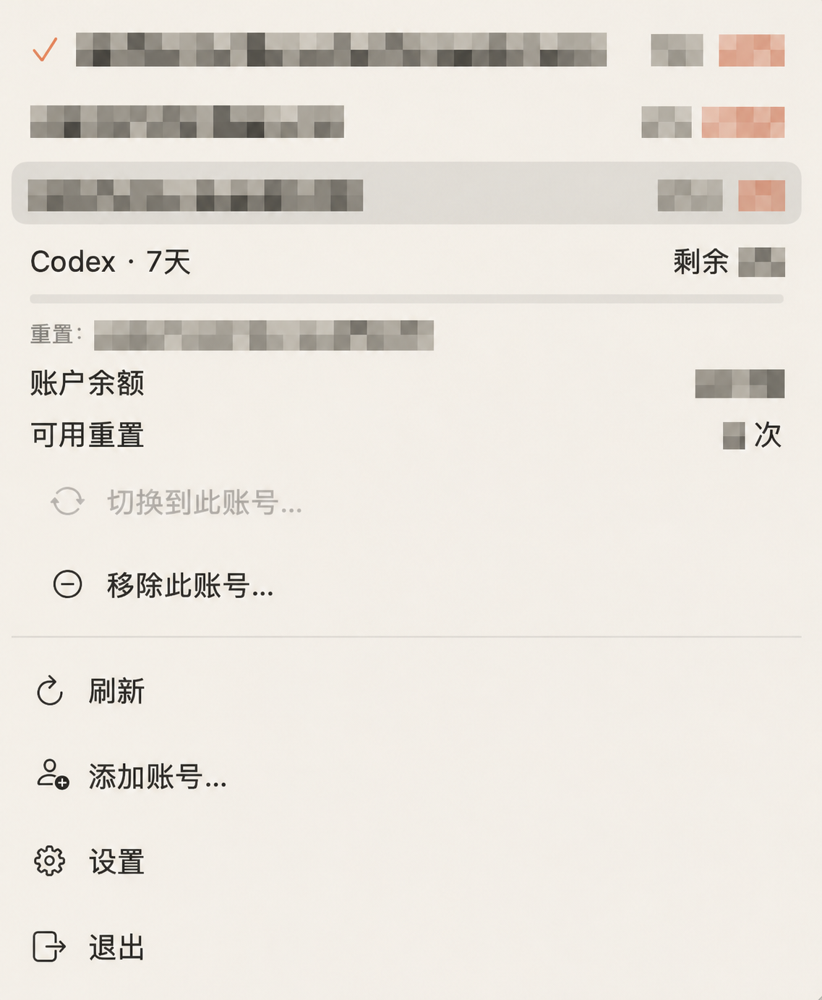

<div align="center">

[English](./README.en.md) | **简体中文**

</div>

<h1 align="center">🥔 poteto</h1>

<p align="center"></p>

<p align="center">macOS 菜单栏里的 Codex 订阅额度与账号管理工具</p>

poteto 显示官方 Codex 订阅的额度与重置时间，支持保存多个官方账号并手动切换。需要 macOS 14 或更新版本。菜单切换使用当前用户的 `~/.codex/auth.json`。添加账号和启动额度计时使用官方 ChatGPT 应用内的 CLI，支持系统或用户的「应用程序」目录，以及系统已登记的安装位置。

## 安装

在 [Releases](https://github.com/jiadizhunine/poteto/releases) 下载 v1.0.6 的 `poteto-v1.0.6-macos-universal.dmg` 或 `poteto-v1.0.6-macos-universal.zip`。两种安装包都包含 Apple Silicon 和 Intel 版本。打开 DMG 或解压 ZIP，将 `poteto.app` 拖到 `/Applications` 或 `~/Applications`，然后打开。

首次打开若遇到 macOS 拦截，先尝试打开应用，再前往 **系统设置 → 隐私与安全性**，选择 **仍要打开**。详情见 [Apple 的打开应用说明](https://support.apple.com/en-us/102445)。

在设置中管理登录时启动。移动应用后，重新开启登录时启动以更新路径。

## 使用

1. 打开 poteto，点击菜单栏中的 🥔。
2. 选择 **添加账号**，在官方登录页面登录。
3. 查看套餐、订阅有效期、额度、重置时间和接口返回的余额或重置券信息。额度每 5 分钟刷新一次，订阅日期随登录凭据更新，读取失败会单独标记。
4. 切换账号前，正常退出 ChatGPT 和 Codex，再选择目标账号。

<p align="center">
  <a href="assets/screenshot-menu-redacted.png"></a>
  <a href="assets/screenshot-redacted.png"></a>
</p>

当所有普通额度窗口满额且重置计时尚未启动时，poteto 会用该账号的默认模型，在独立会话中发送一条短消息启动计时，每周期至多一次。测试消耗少量订阅额度。

当前 ChatGPT 使用共享的本地项目布局。poteto 切换登录凭据，项目和聊天归属由原生客户端保留。

使用旧版 ChatGPT 的账号分区布局时，poteto 会自动补齐目标账号缺少的本地项目和聊天归属，并保留目标账号已有的整理。首次把项目带到一个账号时，先在 ChatGPT 登录该账号一次，然后完全退出 ChatGPT 和 Codex。云端项目归所属账号管理。

旧版账号分区布局中侧栏为空时，可以用 `--project-status` 查看已保存的来源。完全退出 ChatGPT 和 Codex 后运行 `--restore-projects`。新版共享布局直接在 ChatGPT 中检查项目。[查看恢复步骤](.agents/skills/poteto/references/project-recovery.md)

账号凭据保存在 macOS 钥匙串中，账号显示信息和额度记录保存在本机。

## 从源码构建

需要 macOS 的 Swift 编译器。`setup-signing.sh` 创建本机固定签名身份，后续构建复用该身份。

```sh
git clone https://github.com/jiadizhunine/poteto.git
cd poteto
bash setup-signing.sh
bash build.sh
bash test.sh
bash install.sh
```

`install.sh` 安装到 `~/Applications/poteto.app` 并启用登录时启动。

想让 AI 帮你安装、维护或恢复项目，可以在仓库里调用 `$poteto`。[项目级 skill](.agents/skills/poteto/SKILL.md)

## 许可证

[MIT](./LICENSE)
